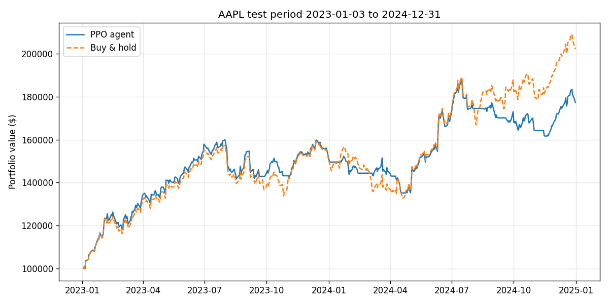

# NeuralTrade — PPO Stock Trading Agent


A reinforcement-learning trading agent (PPO, Stable-Baselines3) that trades a single stock on daily bars,
trained on 2019–2022 and evaluated out-of-sample on 2023–2024 against a buy-and-hold baseline.

> Research / backtesting project only. Not financial advice.

## How it works

- **Data**: real daily OHLCV from Yahoo Finance (`yfinance`), 2019-01-01 to 2025-01-01. Ticker is set by `TICKER` in [src/common.py](src/common.py) (`AAPL` by default; `MSFT`/`GOOGL` also work).
- **Features**: SMA10/50, EMA20, RSI14, MACD/signal/histogram, Bollinger bands (+%B), ATR14, ADX14, computed from real High/Low/Close. Price-level indicators are expressed relative to the close price so they are comparable across years.
- **Environment** ([src/environment.py](src/environment.py), Gymnasium API):
  - $100,000 starting cash; actions `0 = hold`, `1 = buy` (go all-in long), `2 = sell` (go flat). No shorting.
  - 0.1% transaction cost per trade.
  - Reward = `log(portfolio_value_t / portfolio_value_{t-1})`.
  - Observation = indicator features z-scored with **train-set** mean/std + `[position flag, cash fraction]`.
  - Trades execute at the close of the day the agent observes; reward comes from the next day's move (no look-ahead).
- **Split by date**: train 2019–2022, test 2023–2024. Normalisation stats are saved next to the model.
- **Training**: PPO `MlpPolicy`, `seed=42`, 200k timesteps by default.

## Installation

```bash
git clone https://github.com/Dhananjay-Vaidya/NeuralTrade.git
cd NeuralTrade
python -m venv venv
source venv/bin/activate        # Windows: venv\Scripts\activate
pip install -r requirements.txt
```

## Usage

Run the pipeline in this order from the repo root:

```bash
python src/datacollection.py          # -> data/raw_AAPL.csv
python src/feature_engineering.py     # -> data/features_AAPL.csv
python src/train_rl_model.py          # -> model/ppo_AAPL.zip + model/ppo_AAPL_norm.json
                                      #    (optional: --timesteps 500000)
python src/evaluation.py              # -> results/metrics.json + results/equity_curve.png
streamlit run app.py                  # dashboard: equity curve, trades, metrics
```

The dashboard loads the trained model and the test period automatically. You can optionally upload a raw
OHLCV CSV (`Date,Open,High,Low,Close,Volume`) to backtest on other data.

## Results

AAPL, out-of-sample test period **2023-01-03 to 2024-12-31**, $100,000 starting capital, 0.1% cost per trade
(from `results/metrics.json`):

| Metric                 | PPO agent | Buy & hold |
|------------------------|----------:|-----------:|
| Total return           |   +77.34% |   +102.13% |
| Sharpe (annualised)    |      1.60 |       1.77 |
| Max drawdown           |   −15.46% |    −16.61% |
| Number of trades       |        27 |          1 |
| Win rate (round trips) |     42.9% |     100.0% |
| Final value            |  $177,338 |   $202,127 |



**The agent underperforms buy-and-hold** on the test period: lower return and lower Sharpe, with a slightly
smaller drawdown. It tracks buy-and-hold closely through mid-2024 but sat partly in cash during AAPL's
late-2024 rally. On the training period it reached a log-return of ~2.2 vs ~1.07 for buy-and-hold, which
points to overfitting to 2019–2022 rather than a transferable edge.

**Limitations**: single asset, daily bars, a single train/test split, fixed 0.1% cost with no slippage or
market-impact model, and a strongly trending test period that favours buy-and-hold.

## Project layout

```
src/common.py               settings (ticker, dates, paths) + data/split/normalisation helpers
src/datacollection.py       download OHLCV
src/feature_engineering.py  technical indicators
src/environment.py          Gymnasium trading environment
src/train_rl_model.py       PPO training
src/evaluation.py           test-period backtest, metrics, equity plot
app.py                      Streamlit dashboard
```

`src/neuraltrade/`, `api/` and `tests/` contain a separate, more configurable package version (FastAPI backend
for the `frontend/`), configured via `config.yaml`.

## Contributing

1. Fork the repository
2. Create a branch (`git checkout -b feature-name`)
3. Commit your changes and push
4. Open a pull request

## License

MIT License. See the LICENSE file for details.
